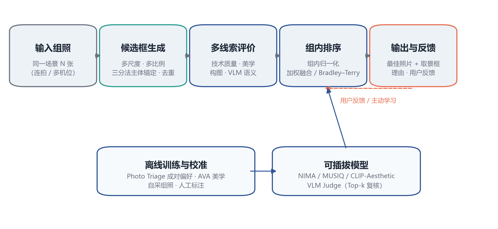
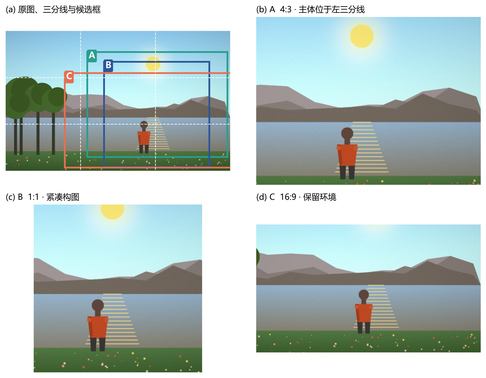
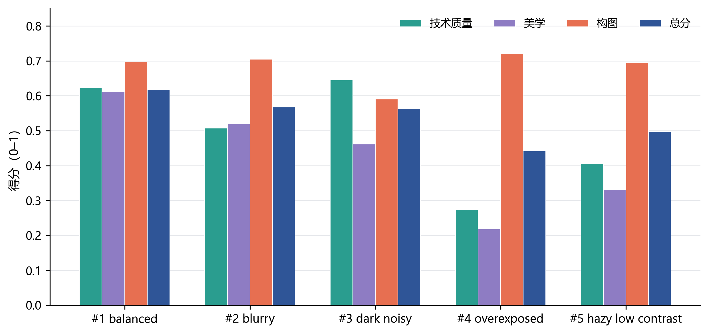
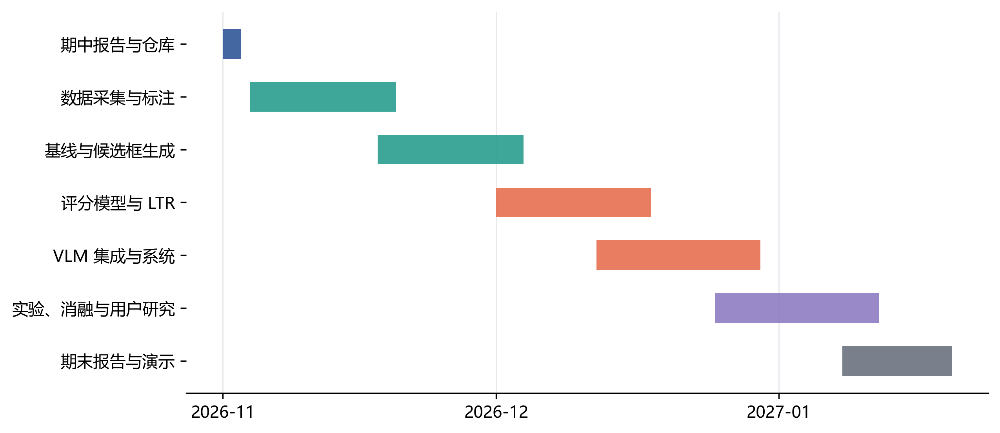

## 摘要

同一场景下连续拍摄的多张照片往往高度相似，人工选片需要逐张比较清晰度、曝光、构图、表情与瞬间，既耗时又带有较强主观性。本报告将“智能选片”定义为**组内相对偏好排序**与**取景框优化**的联合问题：给定同一场景的一组照片，系统需要选出最值得保留的一张，并在必要时给出更优的取景框。报告系统调研了图像美学评价、图像编辑与自动构图、图像偏好学习、排序学习和多模态大模型五条技术路线，分析其适用边界；在此基础上提出“候选框生成—多线索评价—组内排序—VLM 复核”的分层系统方案。候选框由多尺度、多比例网格与三分法主体锚定共同生成，经交并比去重和轻量先验剪枝控制在每图 80 个以内；评价阶段融合技术质量、美学先验、构图规则与多模态大模型的语义判断；最终在组内做归一化，并以 Bradley–Terry 成对排序模型或加权融合完成选择。报告还给出了基于 Photo Triage、AVA、GAICD 及自采组照的数据与实验计划，包括人工成对标注、基线、消融和用户研究。当前代码仓库仅包含用于验证流程可行性的原型骨架、合成演示与单元测试，不构成完整系统；模型训练、真实数据实验与系统完善将在期末完成。

**关键词：** 智能选片；图像美学评价；自动构图；图像偏好学习；学习排序；多模态大模型

## 1 问题理解与任务定义

### 1.1 研究背景

手机与相机的连拍、HDR、多帧合成以及“多拍几张再挑”的拍摄习惯，使得个人相册中充斥着大量近冗余照片。面对同一场景的一组照片，人通常会快速比较：主体是否清晰完整、曝光是否合适、构图是否舒服、表情与动作是否自然，最终保留一张“最有感觉”的。这一过程在摄影工作流中被称为**选片（photo triage / culling）**。

选片与通用的图像质量评价并不相同。通用质量评价回答“这张图本身好不好”，而选片回答“在这组图里哪张更值得留”。后者的参照系是同一场景的其他照片，差异往往非常细微：同一机位下曝光相差半档、主体偏移几十像素、表情相差一瞬。绝对质量指标在这种近冗余比较中容易饱和，而构图、主体完整性和“决定性瞬间”等语义因素反而成为决定性的。因此，智能选片需要同时处理**低层质量**、**构图美学**和**高层语义**三个层次。

Chang 等人发表于 SIGGRAPH 2016 的工作“Automatic Triage for a Photo Series”为这一问题提供了经典的问题设定与数据基础：他们从个人相册中整理了 5,953 个组照、共 15,545 张照片，并通过人类偏好标注建立了组内相对质量的基准，证明“人们在组内的选择”是可以通过机器学习建模的。该工作也说明，选片不是纯粹的艺术玄学，而是一个可以定义、可以标注、可以评测的视觉任务。

### 1.2 任务形式化

给定同一场景拍摄的一组照片

S = {I_1, I_2, …, I_N}

以及可选的场景描述 c（例如“海边日落人像”），系统需要输出：

1. **最佳照片索引** i* ∈ {1, …, N}；
2. **最佳取景框** b_i* = (x, y, w, h)，即在该照片坐标系内的裁剪窗口；当原图构图已经最佳时，b_i* 可以是整幅图像。

系统可以分解为两个层次的优化：

- 单图取景：b_i* = argmax_{b ∈ B_i} S(I_i, b)，其中 B_i 为第 i 张图的候选取景框集合，S 为多线索评分函数；
- 组内选择：i* = argmax_i R(f_i)，其中 f_i 为第 i 张图最佳取景对应的特征向量，R 为组内排序函数。

优化的最终目标是最大化与人类多数偏好的**一致概率**，即

P(i* = argmax_i human_preference(S))。

这一形式化有三个值得强调的细节。第一，输出不只是“选哪张”，还包括“怎么裁”，因为同一张照片的不同取景可能显著改变画面质量；第二，评价是**相对**的，同一组内的照片共享场景、光线和设备，绝对分数需要做组内校准；第三，允许系统给出置信度与理由，方便用户复核，而不是黑箱地替用户做决定。

### 1.3 主要难点

**（1）主观性与标注噪声。** 不同人对同一组照片的偏好可能不同，甚至同一个人在不同时间的选择也不一致。若直接回归“美学分数”，标签噪声会很大。更稳妥的做法是收集**成对比较**或组内排序，再用多数投票得到软标签，并在建模时保留不确定性。

**（2）近冗余导致区分度低。** 连拍照片之间像素差异很小，全局清晰度、色彩等指标几乎相同；真正有区分力的往往是主体是否被切、眼睛是否睁开、地平线是否水平、留白是否合适等细粒度因素。这要求评价器具备局部与语义层面的感知能力。

**（3）无参考、无绝对标准。** 选片没有唯一的“正确答案”，同一组照片可能有多张都值得保留。评价应以排序一致性、Top-1 一致率等相对指标为主，而不是简单的回归误差。

**（4）构图规则的情境依赖。** 三分法、黄金分割、留白等规则在多数情况下有效，但并非绝对；对称构图、中心构图、大面积留白也可能是好照片。规则化评分只能作为先验，需要数据驱动的偏好模型和语义判断来修正。

**（5）候选框组合爆炸。** 一张 1200×900 的图有约 10^11 个可能的矩形裁剪，不可能穷举。需要在保证召回率的前提下，用几何先验、显著性和主体检测把候选压缩到几十个。

**（6）域偏移与工程约束。** 训练数据多来自摄影社区或公开数据集，与普通用户的手机照片在设备、场景、风格上存在差异；同时系统需要在一组照片上快速完成推理，不能对每个候选都调用昂贵的大模型。

### 1.4 评价标准

针对上述难点，本项目采用多层评价体系：

- **组内 Top-1 一致率**：系统选择与人类多数选择一致的比例，是最直观的主指标；
- **成对偏好准确率**：在人工成对比较上，系统排序与人类一致的比率；
- **NDCG@k 与 Kendall τ**：衡量整组排序质量，而不仅是第一名；
- **取景质量**：与人工标注裁剪框的 IoU、构图偏好的人类投票；
- **效率**：单组推理时延、内存占用、VLM 调用次数；
- **可解释性**：分项得分与理由是否能让用户理解并信任。

### 1.5 本报告与期中任务要求的对应

| 任务要求 | 本报告对应内容 |
|---|---|
| 问题理解与任务定义 | 第 1 章：背景、形式化、难点与评价标准 |
| 相关方法调研：美学评价、图像编辑、偏好学习、排序学习中的一种 | 第 2.1–2.4 节：四条路线均有覆盖 |
| 相关方法调研：多模态大模型等技术路线中的一种 | 第 2.5 节：MLLM/VLM 的能力、用法与风险 |
| 初步系统方案：候选区域生成、逐候选评价、最优取景框选择 | 第 3.2–3.4 节：与要求逐项对应 |
| 数据与实验计划：数据、收集方式、人工标注 | 第 4 章：公开数据、自采方案、标注协议与实验设计 |
| 代码托管平台与远程仓库 | GitHub 仓库 smart-photo-selection，含可运行原型 |

## 2 相关方法调研

### 2.1 图像美学评价（Image Aesthetic Assessment, IAA）

图像美学评价旨在预测人类对图像美感的判断，通常形式化为分类（低/高美感）、回归（1–10 分）或分布预测。早期方法依赖手工特征：色彩和谐度、对比度、饱和度、清晰度、构图显著性、纹理复杂度等，再配合 SVM 或回归模型。AVA 数据集（Murray 等，CVPR 2012）包含约 25 万张照片及大量用户评分，是该领域最重要的基准之一，也暴露了美学评价的主观性：同一张图的标准差往往很大。

深度学习方法逐渐成为主流。NIMA（Talebi 与 Milanfar，IEEE TIP 2018）不直接回归平均分，而是预测 1–10 分的**分布**，并用 Earth Mover's Distance 作为损失，使模型同时刻画均值与不确定性；MUSIQ（Ke 等，ICCV 2021）面向真实场景的图像质量评价，采用多尺度 Transformer 处理不同分辨率的输入；基于 CLIP 的美学预测器（如 LAION-Aesthetics）则利用大规模图文预训练特征，以较小的标注成本获得可用的美学先验。近年来，Q-Align 等工作尝试用多模态大模型以离散文本等级进行视觉评分，把“美学判断”转化为语言模型的可解释输出。

这些方法对本项目有三点启示。第一，预训练美学模型可以作为**单图先验**，降低对自采标注的依赖；第二，分布预测比单点回归更适合处理主观性，可以把方差作为不确定性参与后续排序；第三，通用美学模型在近冗余组照上的区分度有限，必须与**组内相对比较**和构图/语义线索结合，不能直接把绝对分数当作最终答案。

### 2.2 图像编辑与自动构图（Image Editing and Auto-Framing）

与选片最直接相关的图像编辑任务是**自动裁剪/重构图**：给定一张图，生成一个更符合审美的取景框。经典流程正是“候选框生成 + 候选评价”。早期工作利用显著性、 gaze、三分法、边界简洁性和内容保留等线索：Santella 等（CHI 2006）用眼动数据驱动半自动裁剪；Fang 等（ACM MM 2014，FLMS）将视觉构图、边界简洁性与内容保留组合成评分模型；Yan 等（CVPR 2013）学习裁剪带来的“变化量”来排序候选框。深度学习方法进一步引入网格锚点与大规模裁剪标注：GAIC（Zeng 等，IEEE TPAMI 2020）提出网格锚点表示和 GAICD 数据集，把裁剪框预测转化为锚点分类与回归，显著提升了效率与精度；后续工作引入构图感知网络、强化学习序列裁剪、以及基于生成模型的扩图/补图来适配不同画幅。

这些工作为第 3 章的候选生成与构图评分提供了直接依据：多尺度、多比例候选、三分法锚定、边界惩罚、主体完整性约束都是经过验证的有效设计。但需要注意两点差异。其一，多数裁剪工作面向**单张图**寻找“最佳裁剪”，不处理一组近冗余照片之间的相对选择；其二，生成式编辑（outpainting/inpainting）会改变画面真实内容，不适合以“记录真实瞬间”为目标的选片场景。因此本项目默认只做**裁剪式取景**，把生成式编辑列为可选增强而非主流程。

### 2.3 图像偏好学习（Image Preference Learning）

偏好学习关注如何从人类的相对判断中学习效用函数。最经典的模型是 Bradley–Terry：对任意两张图 i、j，假设

P(i ≻ j) = σ(u_i − u_j)，

其中 u 为潜在效用。给定成对标注，可以用最大似然估计得到 u 或特征权重。这一模型天然适配选片：用户不需要给出绝对分数，只需回答“这两张里你更喜欢哪张”。Chang 等的 Photo Triage 工作正是沿这一思路，利用组内人类偏好训练相对质量预测器。

在生成模型领域，偏好学习近年发展迅速。RLHF（Christiano 等，NeurIPS 2017）用人类比较训练奖励模型，再以强化学习优化生成策略；DPO（Rafailov 等，NeurIPS 2023）把偏好优化转化为更稳定的监督目标；ImageReward、PickScore、HPSv2 等工作则构建了图文生成的偏好奖励模型。这些模型虽面向生成图像，但其“人类偏好 → 可微分评分”的建模范式可以迁移到选片：把照片视为候选，把组内选择视为偏好信号，训练一个轻量的偏好评分器。

偏好学习在本项目中的角色是**组内排序的核心**。相比绝对美学回归，成对模型对标签噪声更鲁棒、样本效率更高，也更容易加入用户个性化反馈。主要风险是偏好可能不满足传递性、标注成本较高，以及不同用户之间的偏好差异；可通过多数投票、混合效应模型或个性化微调缓解。

### 2.4 排序学习（Learning to Rank, LTR）

排序学习研究如何为查询下的文档列表学习排序函数，主要分为 pointwise、pairwise 和 listwise 三类。pointwise 把每个样本独立回归到相关性分数；pairwise 关注样本对的相对顺序，代表工作是 RankNet（Burges 等，2005）及其改进 LambdaRank（Burges 等，NIPS 2006），后者直接优化 NDCG 等不可微指标；listwise 则把整个列表作为优化对象，如 ListNet（Cao 等，ICML 2007）。工业界常用的 LambdaMART 结合了 pairwise 梯度与树模型，在搜索排序中长期表现优异。

把选片视为排序问题非常自然：一组照片就是一个“查询”下的文档列表，组内偏好就是相关性标签。与搜索排序不同的是，选片的列表很短（通常 3–10 张）、特征维度不高、标注样本有限，因此不需要复杂的深度排序模型；pairwise 逻辑回归或小型梯度提升树往往足够，且可解释性强。评估可使用成对准确率、NDCG@k 和 Kendall τ。组内归一化（例如把每个线索转化为组内百分位）是重要的工程技巧，可以消除整组偏暗、偏色等全局偏差。

### 2.5 多模态大模型（MLLM / VLM）

多模态大模型把视觉编码器与语言模型结合，具备开放场景的语义理解与推理能力。代表性工作包括 LLaVA（Liu 等，NeurIPS 2023）、Qwen2-VL（Wang 等，2024）、GPT-4V/GPT-4o、Claude 系列与 Gemini 等。它们可以回答“这张照片的主体是否完整”“构图是否平衡”“哪张更有故事感”之类的问题，并给出自然语言理由，这恰好弥补了手工特征与小型美学模型在语义层面的不足。

近期研究开始系统评估 MLLM 的美学能力。Q-Align 用离散文本等级（如“优秀/良好/一般/较差”）让 LMM 完成视觉评分，在多个 IQA/美学基准上取得有竞争力的结果；AesBench 则构建了面向 MLLM 的美学感知基准，发现模型在整体印象上表现不错，但在细粒度构图、光影和风格判断上仍与人类有差距。此外，MLLM 作为评审（LLM-as-a-judge）存在位置偏差、长度偏差、提示敏感等问题，绝对打分也不够稳定。

因此，本项目对 VLM 的定位是**少量候选的语义复核与难例仲裁**，而不是全量评分器。具体做法包括：只对每个候选框的技术/美学/构图初筛后的 Top-k 调用 VLM；使用结构化评分量表与 JSON 输出；优先使用成对比较而非绝对分数；对多张照片随机交换顺序以降低位置偏差；把 VLM 分数与轻量线索融合，并保留其理由供用户查看。这样既利用了语义理解，又控制了成本、延迟与幻觉风险。

### 2.6 调研小结与技术选型

| 技术路线 | 代表工作 | 优点 | 局限 | 在本项目中的角色 |
|---|---|---|---|---|
| 图像美学评价 | AVA、NIMA、MUSIQ、CLIP-Aesthetic | 有成熟预训练模型，单图先验强 | 近冗余区分度低，存在数据集偏差 | 单图美学先验，可插拔 |
| 图像编辑/自动构图 | FLMS、GAIC、GAICD | 候选生成与构图评分可直接复用 | 多针对单图，不处理组内选择 | 候选框生成与构图评价 |
| 图像偏好学习 | Bradley–Terry、Photo Triage、ImageReward | 适配相对判断，抗噪、可个性化 | 标注成本，偏好非传递 | 组内偏好建模与排序 |
| 排序学习 | RankNet、LambdaRank、ListNet | 直接优化排序指标，列表级视角 | 小样本下易过拟合 | 组内排序器与特征融合 |
| 多模态大模型 | LLaVA、Qwen2-VL、GPT-4V、Q-Align、AesBench | 语义理解强，可解释 | 成本、延迟、偏差、幻觉 | Top-k 语义复核与难例仲裁 |

综合来看，单一方法难以同时满足精度、效率与可解释性。本项目采用**级联式混合方案**：以轻量的多线索评分完成全量候选筛选，以组内偏好学习/排序学习完成最终选择，以 VLM 处理少量疑难候选；美学评价模型、偏好模型和 VLM 都设计为可插拔接口，便于在期末阶段根据实验替换与消融。

## 3 初步系统方案

本章给出初步系统方案，重点是问题分解、模块划分、模块间接口与最终选择逻辑，不追求完整实现与最终性能指标。文中的参数取值、权重与候选规模均为基于经验的初始设定，将在期末通过真实数据实验调整。

### 3.1 总体架构

系统分为在线推理与离线训练两条链路（图 1）。在线链路接收一组照片，依次完成预处理、候选框生成、多线索评价、组内排序与结果输出；离线链路负责收集偏好数据、训练美学/偏好/排序模型，并对 VLM 评分做校准。两条链路通过统一的特征与模型接口连接，保证在线推理不依赖昂贵的训练过程。



在线部分的设计原则是“**先宽后严、先轻后重**”：候选生成阶段尽量保证召回，评价阶段用廉价线索快速过滤，只有少量高分候选进入 VLM 或复杂模型。这样既控制了计算量，也避免了大模型对全量候选产生的高昂成本。

### 3.2 候选取景区域如何生成

候选框生成的目标不是穷举，而是在有限数量内覆盖“人类可能选择的取景方式”。原型系统采用三类策略的组合（图 2）。

**（1）几何网格候选。** 对常见的画幅比例（1:1、4:3、3:2、16:9）和多个缩放尺度（相对最大可用框的 0.55、0.72、0.88、1.0），在图像上以 3×3 网格滑动生成候选框，并始终保留整幅原图。多比例覆盖了社交媒体、打印、手机屏幕等不同使用场景；多尺度则兼顾“保留环境”和“突出主体”。

**（2）主体与显著性引导。** 计算谱残差显著性图（Hou 与 Zhang，CVPR 2007），取其高显著区域的质心作为主体位置估计；对每个候选尺寸，额外生成把质心放在四个三分点（1/3、2/3 组合）上的候选框。这样可以直接产生符合三分法且主体完整的构图。对于人像，进一步用 Haar 级联检测人脸，若人脸距离裁剪边界过近则施加惩罚；后续可替换为更稳健的人脸/人体检测器或分割模型。

**（3）语义候选（可选）。** 在数据与算力允许时，可让 VLM 或目标检测/分割模型给出“主体框”或“建议裁剪区域”，作为几何候选的补充。原型阶段未默认启用，以避免引入额外延迟与不稳定性。

**（4）去重与剪枝。** 候选框之间用交并比（IoU）做贪心非极大值抑制，阈值 0.92；再按一个廉价先验排序，保留每图至多 80 个候选。该先验由三部分组成：裁剪内显著性质量占比、主体质心与三分点的接近程度、显著性靠近边界的惩罚。复杂度为 O(K)，K 为候选数，远低于像素级穷举。



需要说明的是，候选生成的**召回率**本身需要评估：如果人类偏好的裁剪框不在候选集合中，后续评分再准也无法选中。期末计划在 GAICD 等带有人工裁剪标注的数据上，统计候选集合对人类裁剪框的覆盖率与最佳 IoU，以指导候选数量与策略的取舍。

### 3.3 每个候选区域如何评价

对每个候选框 b，系统计算四类分数，并线性融合为总分：

S(I, b) = w_t·T(I, b) + w_a·A(I, b) + w_c·C(I, b) + w_s·V(I, b)

其中 T、A、C、V 分别表示技术质量、美学、构图和语义分数，均归一化到 [0, 1]，w 为可学习或可配置的权重。默认权重为 0.30、0.20、0.30、0.20，强调技术质量与构图，同时给语义判断留出空间。

**（1）技术质量 T。** 包括清晰度（拉普拉斯方差，先在固定高度上缩放以消除分辨率偏差）、曝光（平均亮度接近中灰的程度与高光/暗部截断比例）、对比度、色彩丰富度（Hasler–Süsstrunk 指标）和噪声水平（中值滤波残差）。这些指标计算廉价，适合全量候选筛选。若检测到人脸，还可加入人脸清晰度、遮挡和姿态等质量项。

**（2）美学 A。** 原型阶段使用一个无依赖的启发式评分器，综合饱和度、色彩丰富度、对比度、清晰度与曝光的和谐程度；接口设计为 `AestheticScorer`，可直接替换为 NIMA、MUSIQ 或 CLIP-Aesthetic 等预训练模型。对于学习型模型，建议同时输出预测分布或不确定性，低置信度样本交给 VLM 复核。

**（3）构图 C。** 这是候选框评价的核心。原型实现了五项指标：裁剪内显著性质量占比（主体是否被保留）、主体质心与三分点的对齐度、左右/上下显著性平衡、主体尺度（避免主体过小或过满）、显著性靠近裁剪边界的惩罚（避免切断主体）。若有人脸，额外惩罚人脸贴边。后续可加入地平线水平度、引导线、留白方向、前景/背景层次等更细的构图特征。

**（4）语义 V。** 由 VLM 按结构化量表打分，维度包括主体完整性、构图、瞬间和整体美学，输出 JSON 及一句理由。原型默认使用中性评分器（不调用外部模型），保证离线可运行；配置 VLM 后，仅对初筛 Top-k 候选调用，并以加权总分融合。为了降低位置偏差，正式实验中会对同一组候选随机交换顺序并做多次评估。

四类分数在进入组内排序前会做**组内归一化**：把每张照片最佳候选的各分项转化为组内百分位。这样做的好处是消除整组曝光偏暗、色彩偏灰等全局因素，让比较聚焦于照片之间的相对差异；同时避免某一分项的数值尺度主导融合结果。

### 3.4 最终如何选择最优取景框

最终选择分为三步。

**第一步：单图最佳取景。** 对每张照片，在其候选集合中取总分最高的裁剪框 b_i*。若最高分低于质量门槛（例如严重失焦或过曝），可将该照片标记为“不可用”，在组内排序中降权。

**第二步：组内排序。** 以每张照片最佳取景的分项分数构成特征向量 f_i = [T, A, C, V]，有两种融合方式：

- **加权融合**：对组内百分位特征做加权求和，得到每张照片的组内得分；
- **学习排序**：用人工成对偏好训练 Bradley–Terry 排序器，P(i ≻ j) = σ(w·(f_i − f_j))，预测时以 w·f_i 作为得分。目标函数为负对数似然加 L2 正则：

L(w) = −Σ_{(i,j)∈P} log σ(w·(f_i − f_j)) + λ‖w‖²

其中 P 为人工标注的偏好对集合。该模型只有 4 个参数，样本效率高、可解释性强，适合期中阶段的小规模数据；数据量增大后可替换为 LambdaRank 或小型 GBDT。

**第三步：VLM 复核与仲裁。** 对组内排名前 2–3 的照片，若分数差距小于阈值，则调用 VLM 做成对比较，重点判断主体完整性、表情/瞬间和构图意图；VLM 的偏好作为额外一票，与排序分数按置信度加权。若仍无法区分，则用清晰度、曝光等技术指标做最终 tie-break，并向用户展示分项得分与理由。

完整的在线流程如下：

```
输入：组照 S = {I_1, ..., I_N}，权重 w，排序器 R，VLM 评审 J
1  for i = 1..N:
2      I_i ← 预处理(I_i)                  # EXIF 方向、尺寸归一化
3      M_i ← 显著性图(I_i); F_i ← 人脸检测(I_i)
4      B_i ← 候选生成(I_i, M_i, F_i)      # 多尺度/多比例/三分法 + NMS
5      for b in B_i:
6          s_b ← w_t·T + w_a·A + w_c·C + w_s·V
7      b_i* ← argmax_{b∈B_i} s_b
8      f_i ← 特征(I_i, b_i*)
9  对 Top-k 照片调用 J 做成对复核（可选）
10 排序 ← R({f_i}); i* ← 排名第一
输出：最佳照片 I_i*，最佳取景框 b_i*
```



图 3 展示了原型在合成的 5 张演示组照上的分项得分。清晰、曝光正常的“balanced”照片在技术质量上占优，最终总分最高；模糊、过曝、欠曝加噪声、低对比雾化的变体分别在对应分项上被拉低。该结果仅用于验证流程连通性，不代表真实数据上的性能。

### 3.5 系统实现与接口

原型采用 Python + OpenCV + NumPy 实现，不依赖深度学习框架即可运行；美学模型与 VLM 通过接口注入，便于替换。仓库结构如下：

| 目录/文件 | 作用 |
|---|---|
| src/sps/candidates.py | 候选取景框生成、去重、可视化 |
| src/sps/scoring.py | 技术质量、美学、构图评分与融合 |
| src/sps/pipeline.py | 单图与组照的原型推理流程 |
| src/sps/ranking.py | 组内归一化、Bradley–Terry 排序器 |
| src/sps/vlm.py | VLM 评审接口、评分量表与提示词 |
| src/sps/demo.py | 合成演示组照与端到端示例 |
| src/sps/cli.py | 命令行入口 |
| tests/test_smoke.py | 候选、排序、演示流程的单元测试 |
| docs/design-report.md | 本设计报告 |
| scripts/make_figures.py | 报告图表生成脚本 |

命令行支持两种用法：

```
# 生成合成演示组照并运行完整流程
python -m sps.cli demo --out outputs/demo

# 对指定目录中的一组照片选片
python -m sps.cli select --input path/to/series --out outputs/run
```

输出包括：最佳照片的裁剪结果 `selected.jpg`、带排名与得分的联系表 `contact_sheet.jpg`、候选取景框可视化 `candidates.jpg`，以及包含每个候选分项得分与详细指标的 `scores.json`。在配备普通 CPU 的笔记本上，5 张 1200×972 的演示照片端到端耗时约 26 秒（每图约 80 个候选），主要开销在逐候选的清晰度与构图计算；期末将通过向量化、候选数自适应和模型批处理进一步优化。

原型当前完成的是“可运行骨架 + 规则评分 + 排序接口”，尚未训练美学模型与偏好模型，也未默认调用 VLM。这一取舍是有意的：期中阶段优先验证问题分解、接口设计与流程可行性，把学习型模型和真实数据实验留到期末。

### 3.6 工程与伦理考虑

选片涉及个人照片，隐私敏感。系统默认在本地完成处理，不主动上传图像；若启用云端 VLM，需要明确告知用户并获得同意，且只上传必要的候选裁剪而非整组原图。系统默认只做裁剪，不对画面内容做生成式修改，避免改变真实记录。输出结果附带分项得分与 VLM 理由，用户可以选择接受或覆盖，系统把用户选择作为新的偏好样本用于后续个性化。对于公开发布的数据集，人脸应做模糊或取得授权，并遵守原始数据集的许可协议。

## 4 数据与实验计划

### 4.1 数据来源

| 数据 | 规模与内容 | 用途 |
|---|---|---|
| Photo Triage（Chang 等，2016） | 5,953 个组照、15,545 张照片，含组内人类偏好 | 主训练/评测集，直接对应选片任务 |
| AVA（Murray 等，2012） | 约 25 万张照片，含 1–10 分美学评分分布 | 美学模型预训练/风格先验 |
| GAICD（Zeng 等，2020） | 带人工裁剪框的图像数据集 | 候选框召回率与裁剪质量评测 |
| 自采组照 | 计划约 300 组、每组 5–10 张，共约 2,000 张 | 贴近真实手机拍摄分布，补充场景多样性 |

Photo Triage 与任务定义最匹配，将作为主数据集，按**组**划分训练/验证/测试（例如 70%/15%/15%），严格避免同一组照片跨集合泄漏。AVA 用于美学预训练或作为零样本先验。GAICD 用于评估候选生成阶段是否覆盖人类裁剪。自采数据用于检验模型在真实手机照片上的泛化能力。

### 4.2 自采数据方案

计划覆盖 6 类场景：人像、风景、街拍、运动、花卉、宠物；兼顾室内/室外、白天/夜晚、逆光/顺光。设备包括 3 台不同品牌的手机和 2 台相机，以引入设备差异。拍摄时要求同一场景至少拍摄 5 张，并在曝光、构图、主体位置、表情/动作上制造自然差异；保留 EXIF 信息，记录场景标签、拍摄意图和隐私授权。

数据按 `data/raw/<series_id>/` 组织，配套 CSV 记录组号、场景、设备、拍摄时间、隐私状态等元信息。公开发布前对人脸、车牌、门牌等敏感信息做模糊处理，或仅发布特征与标注而不发布原图。

### 4.3 人工标注方案

标注是选片任务的核心成本，也是评测可信度的基础。计划采用三层标注：

| 标注类型 | 形式 | 用途 |
|---|---|---|
| 组内成对偏好 | 对每组内的照片两两比较，选择更喜欢的一张；组内超过 6 张时随机采样部分对 | 训练 Bradley–Terry/排序模型，计算成对准确率 |
| 组内最佳 | 从每组中直接选出最值得保留的 1–2 张 | 计算 Top-1 一致率，作为主评测指标 |
| 属性与裁剪 | 可选标注清晰度、曝光、构图、表情四项 1–5 分；对部分图片标注理想裁剪框 | 分项诊断、构图评价与候选召回评估 |

标注人员计划 10 人以上，覆盖不同摄影经验；每人独立完成，采用多数投票得到软标签。抽取 20% 样本重复标注以估计一致性，目标 Krippendorff's α 或 Fleiss κ 不低于 0.6；低于阈值的样本进入复核。标注界面随机化左右顺序、隐藏文件名与 EXIF，避免品牌、文件名等无关线索影响判断；加入少量注意力检查题。

按 Photo Triage 的规模估算，约 6,000 组、每组约 10 个成对比较，总计约 6 万次比较；以每人每小时 150–200 次比较计算，约需 300–400 人时。期中后先完成 1,000 组的试点标注，验证标注协议与一致性，再扩展到全量。

### 4.4 实验设置

**基线方法：**

- 随机选择；
- 单指标启发式：清晰度最大、曝光最接近中灰、对比度最大；
- 预训练美学模型：NIMA、MUSIQ、CLIP-Aesthetic 直接取最高分；
- 多模态大模型零样本：Qwen2.5-VL 或 GPT-4o 按统一提示词直接选择；
- Photo Triage 类特征模型：使用其相对质量特征训练分类/回归。

**本系统变体：**

- 仅技术质量（w/o 构图、美学、语义）；
- 技术 + 美学 + 构图，不使用 VLM；
- 完整系统（加入 VLM Top-k 复核）；
- 完整系统 + 成对偏好排序器（替换固定权重）。

**指标：** Top-1 一致率、成对偏好准确率、NDCG@3、Kendall τ、裁剪 IoU/覆盖率、单组时延、VLM 调用次数与成本。所有实验重复 5 次，报告均值与 95% 置信区间；显著性检验采用配对 bootstrap。

### 4.5 消融与敏感性分析

计划考察以下因素：

- **候选数量**：20/40/80/120，观察召回率、时延与最终准确率的变化；
- **候选比例与尺度**：是否包含 1:1、16:9，尺度粒度的影响；
- **权重**：技术/美学/构图/语义四组权重的敏感性，以及学习权重与手工权重的差异；
- **组内归一化**：使用百分位、z-score 与不归一化的对比；
- **美学模型**：启发式、NIMA、MUSIQ、CLIP-Aesthetic 的单独与集成效果；
- **VLM**：Top-k 的 k 值、绝对打分与成对比较、单模型与多模型集成；
- **排序器**：加权融合、Bradley–Terry、LambdaRank/GBDT 的样本效率与上限。

### 4.6 用户研究

除离线指标外，计划进行小规模用户研究：招募 20 名参与者，每人完成 50 组选片，对比本系统与最强基线的选择；记录偏好率、完成时间与主观评分（SUS 可用性量表），并进行简短访谈，重点了解系统理由是否可信、是否愿意采纳。用户研究同时用于收集新的偏好对，形成“使用—反馈—改进”的闭环。

### 4.7 进度计划



| 阶段 | 时间 | 主要任务 | 交付物 |
|---|---|---|---|
| 期中 | 11/1–11/3 | 问题定义、调研、方案设计、仓库搭建 | 本报告、可运行原型、GitHub 仓库 |
| 数据 | 11/4–11/20 | 标注工具、1,000 组试点标注、自采数据 | 标注规范、试点数据、一致性报告 |
| 基线 | 11/18–12/4 | 实现基线与候选生成评估 | 基线结果、候选召回报告 |
| 建模 | 12/1–12/18 | 美学模型接入、偏好/排序模型训练 | 训练好的评分器与排序器 |
| 系统 | 12/12–12/30 | VLM 集成、端到端优化、演示界面 | 完整系统与演示 |
| 实验 | 12/25–1/12 | 主实验、消融、用户研究 | 实验报告、图表 |
| 收尾 | 1/8–1/20 | 期末报告、代码整理、答辩准备 | 期末报告、最终仓库 |

### 4.8 风险与应对

| 风险 | 影响 | 应对 |
|---|---|---|
| 数据许可或隐私限制 | 无法公开数据或复现 | 优先使用可公开的 Photo Triage/AVA；自采数据做脱敏，必要时只发布特征与标注 |
| 标注一致性低 | 训练信号噪声大，评测不可信 | 试点标注、明确规范、多数投票、一致性阈值与复核机制 |
| VLM 成本/延迟高 | 无法实时，实验预算超支 | 仅 Top-k 调用、缓存、批处理、本地小模型优先 |
| 过拟合小数据集 | 泛化差 | 按组划分、交叉验证、强正则、使用预训练先验 |
| 候选召回不足 | 上限受限 | 在 GAICD 上评估召回，增加尺度/比例与主体引导候选 |
| 进度延误 | 期末交付风险 | 每周检查里程碑，优先保证主流程与主实验，裁剪可选功能 |

<!-- pagebreak -->

## 5 团队分工

本项目按工作包组织，具体划分如下。

| 工作包 | 主要职责 | 成员 |
|---|---|---|
| 算法与系统设计 | 问题定义、系统架构、候选框生成、评分与排序模型、实验设计 | 王颖超（202393005） |
| 数据与标注 | 数据采集方案、标注协议、标注工具与质量控制 | 王颖超（202393005） |
| 工程实现 | 仓库维护、流水线实现、CLI 与演示、单元测试与 CI | 王颖超（202393005） |
| 多模态/VLM | VLM 接口、结构化提示词、语义评价与校准方案 | 王颖超（202393005） |
| 报告与分析 | 文献调研、图表绘制、实验分析与报告撰写 | 王颖超（202393005） |

项目按周设置里程碑（见 4.7 节进度安排），使用 GitHub Issues 与提交记录跟踪任务；每次修改通过功能分支完成并附自查清单，保证过程可追溯。后续若组队，可在此表基础上按角色拆分。

## 6 总结

本报告围绕“同场景组照的智能选片”完成了期中阶段的设计工作。主要贡献包括：

1. 将选片形式化为**单图取景优化 + 组内相对排序**的联合问题，明确了输入输出、评价指标与主要难点；
2. 系统调研了图像美学评价、图像编辑/自动构图、图像偏好学习、排序学习和多模态大模型五条路线，给出了各自的能力边界与本项目中的定位；
3. 提出了“候选框生成—多线索评价—组内排序—VLM 复核”的分层系统方案，详细说明了候选如何生成、每个候选如何评价、最终如何选出最优取景框；
4. 制定了基于 Photo Triage、AVA、GAICD 与自采组照的数据与实验计划，涵盖标注协议、基线、消融和用户研究；
5. 搭建了 GitHub 仓库与可运行原型骨架，完成合成演示与单元测试，验证了流程可行性，为期末迭代提供了工程基础。

下一步将重点推进三件事：完成试点数据标注与候选召回评估；接入 NIMA/MUSIQ 等美学模型并训练 Bradley–Terry 排序器；在真实组照上开展主实验与消融，验证各条技术路线的实际贡献。

## 参考文献

[1] Chang H, Yu F, Wang J, Ashley D, Finkelstein A. Automatic Triage for a Photo Series. ACM Transactions on Graphics (Proc. SIGGRAPH), 2016, 35(4).

[2] Murray N, Marchesotti L, Perronnin F. AVA: A Large-Scale Database for Aesthetic Visual Analysis. CVPR, 2012.

[3] Talebi H, Milanfar P. NIMA: Neural Image Assessment. IEEE Transactions on Image Processing, 2018, 27(8): 3998–4011.

[4] Ke J, Wang Q, Wang Y, Milanfar P, Yang F. MUSIQ: Multi-Scale Image Quality Transformer. ICCV, 2021.

[5] Deng Y, Loy C C, Tang X. Image Aesthetic Assessment: An Experimental Survey. IEEE Signal Processing Magazine, 2017, 34(4): 80–106.

[6] Santella A, Agrawala M, DeCarlo D, Salesin D, Cohen M. Gaze-Based Interaction for Semi-Automatic Photo Cropping. CHI, 2006.

[7] Fang C, Lin Z, Mech R, Shen X. Automatic Image Cropping Using Visual Composition, Boundary Simplicity and Content Preservation Models. ACM Multimedia, 2014.

[8] Yan J, Lin S, Kang S B, Tang X. Learning the Change for Automatic Image Cropping. CVPR, 2013.

[9] Zeng H, Li L, Cao Z, Zhang L. Grid Anchor Based Image Cropping: A New Benchmark and An Efficient Model. IEEE TPAMI, 2020.

[10] Burges C J C. From RankNet to LambdaRank to LambdaMART: An Overview. Microsoft Research Technical Report, 2010.

[11] Burges C J C, Ragno R, Le Q V. Learning to Rank with Nonsmooth Cost Functions. NIPS, 2006.

[12] Cao Z, Qin T, Liu T Y, Tsai M F, Li H. Learning to Rank: From Pairwise Approach to Listwise Approach. ICML, 2007.

[13] Qin T, Liu T Y, Li H. A General Approximation Framework for Direct Optimization of Information Retrieval Measures. Information Retrieval, 2010, 13(4): 375–397.

[14] Bradley R A, Terry M E. Rank Analysis of Incomplete Block Designs: I. The Method of Paired Comparisons. Biometrika, 1952, 39(3/4): 324–345.

[15] Christiano P F, Leike J, Brown T B, Martic M, Legg S, Amodei D. Deep Reinforcement Learning from Human Preferences. NeurIPS, 2017.

[16] Rafailov R, Sharma A, Mitchell E, Ermon S, Manning C D, Finn C. Direct Preference Optimization: Your Language Model is Secretly a Reward Model. NeurIPS, 2023.

[17] Xu J, Liu X, Wu Y, et al. ImageReward: Learning and Evaluating Human Preferences for Text-to-Image Generation. NeurIPS, 2023.

[18] Kirstain Y, Polyak A, Singer U, Matiana S, Penna J, Levy O. Pick-a-Pic: An Open Dataset of User Preferences for Text-to-Image Generation. NeurIPS, 2023.

[19] Wu X, Hao Y, Sun K, et al. Human Preference Score v2: A Solid Benchmark for Evaluating Human Preferences of Text-to-Image Synthesis. arXiv:2306.09341, 2023.

[20] Liu H, Li C, Wu Q, Lee Y J. Visual Instruction Tuning. NeurIPS, 2023.

[21] Wang P, Bai S, Tan S, et al. Qwen2-VL: Enhancing Vision-Language Model's Perception of the World at Any Resolution. arXiv:2409.12191, 2024.

[22] Wu H, Zhang Z, Zhang W, et al. Q-Align: Teaching LMMs for Visual Scoring via Discrete Text-Defined Levels. ICML, 2024.

[23] Huang Y, Yuan Z, Sheng Y, et al. AesBench: An Expert Benchmark for Multimodal Large Language Models on Image Aesthetics Perception. arXiv:2401.08276, 2024.

[24] Hou X, Zhang L. Saliency Detection: A Spectral Residual Approach. CVPR, 2007.

[25] Itti L, Koch C, Niebur E. A Model of Saliency-Based Visual Attention for Rapid Scene Analysis. IEEE TPAMI, 1998, 20(11): 1254–1259.

[26] Mittal A, Moorthy A K, Bovik A C. No-Reference Image Quality Assessment in the Spatial Domain. IEEE Transactions on Image Processing, 2012, 21(12): 4695–4708.

## 附录 A 原型运行说明

环境要求：Python 3.9+、NumPy、OpenCV；报告生成与图表另需 matplotlib、python-docx。

```
# 安装（可编辑模式）
pip install -e .

# 运行合成演示
python -m sps.cli demo --out outputs/demo

# 对真实组照目录选片
python -m sps.cli select --input path/to/series --out outputs/run

# 运行单元测试
python -m unittest discover -s tests -v

# 重新生成报告图表
python scripts/make_figures.py
```

原型在合成演示组照上选择 `01_balanced.jpg`，与预期一致；单元测试覆盖候选框边界与去重、排序器、端到端演示流程。由于演示图像为程序合成，所得分数仅用于验证流程，不作为算法性能结论。
